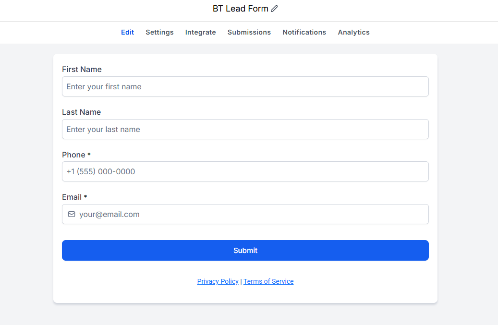
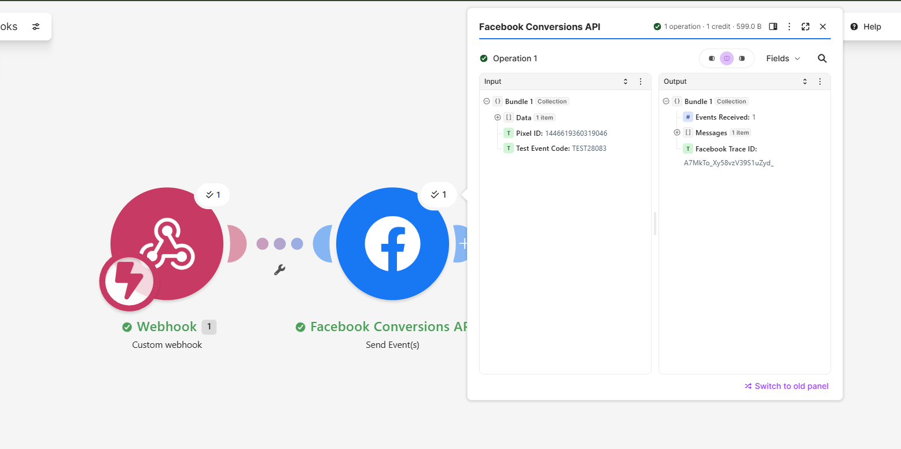
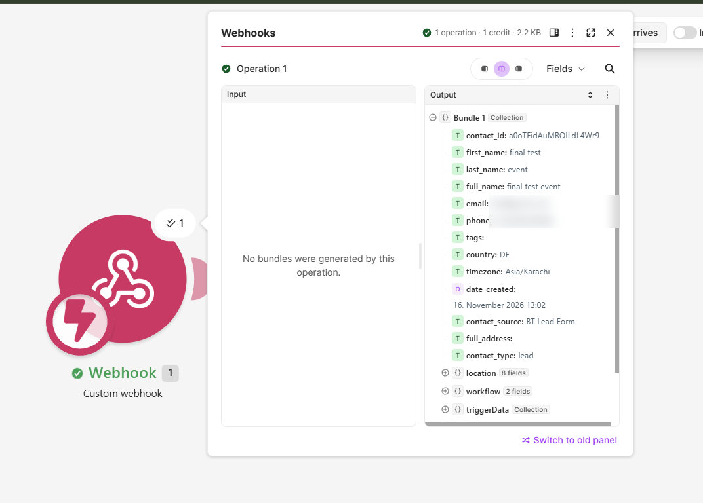
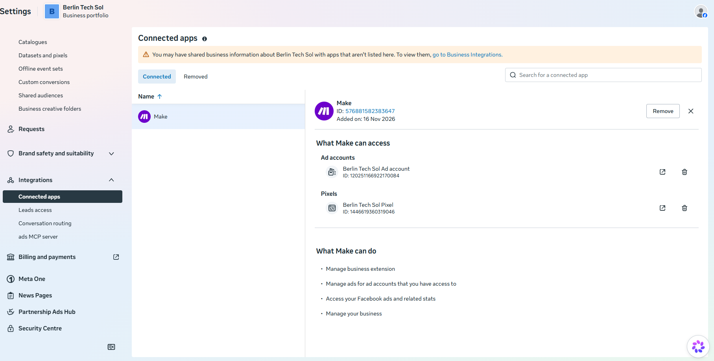
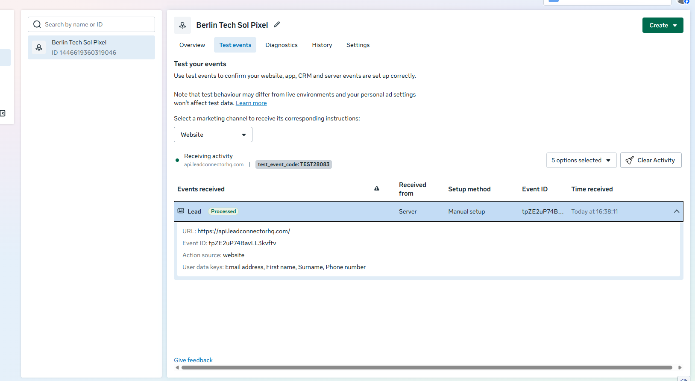
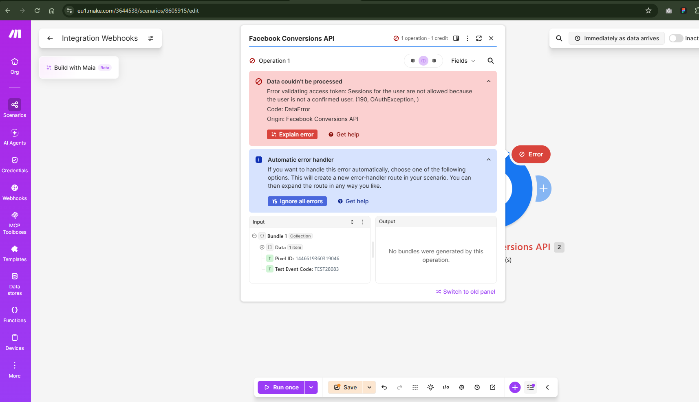
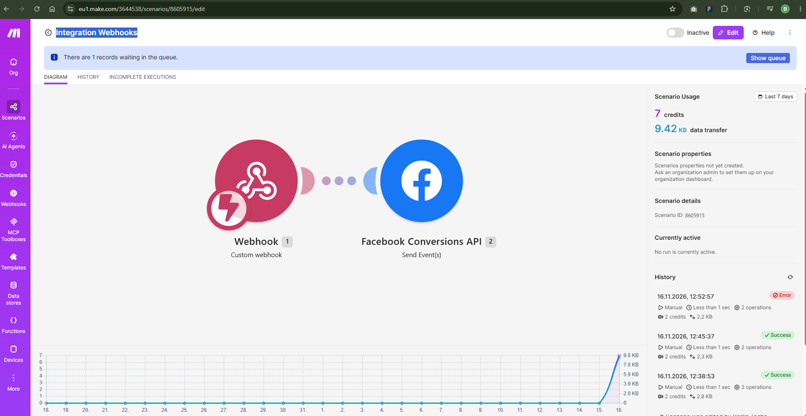
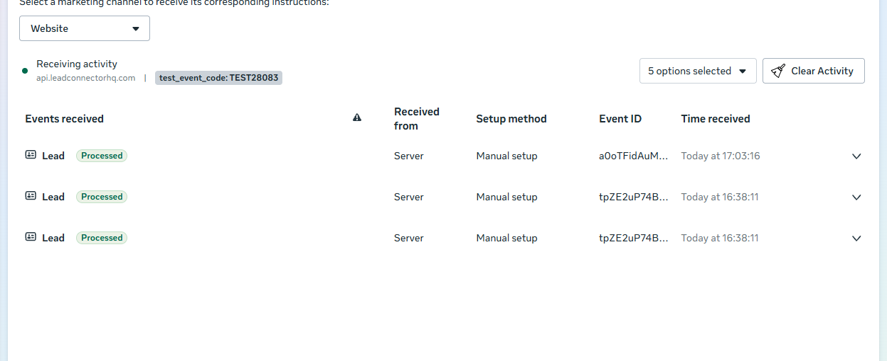
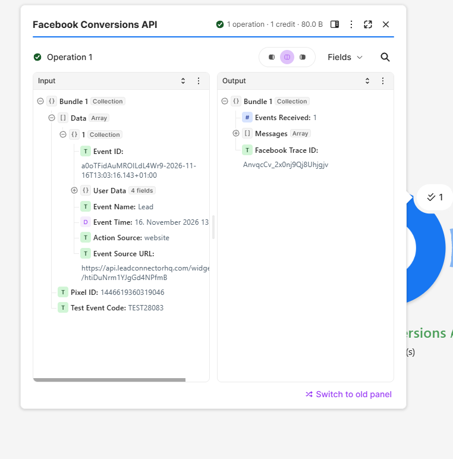

# GoHighLevel → Make → Meta Conversions API

A working integration that sends GoHighLevel form leads to Meta as server-side `Lead` events, through a Make scenario. Built and tested in live GoHighLevel, Make and Meta accounts in November 2026.

It also documents the most common failure in this setup, the Meta OAuth error (code 190, which Make often reports as a 401), with the cause and the fix reproduced step by step.

Built by Abdul Wasea, Berlin Tech Sol.

## How it works

```
GoHighLevel form ──► GHL workflow ──► Make webhook ──► Facebook Conversions API ──► Meta dataset
 (BT Lead Form)     (Form Submitted     (Custom          (Send Event(s),             (Lead event,
                     → Webhook POST)      webhook)         Lead)                       server)
```

1. A lead submits the GoHighLevel form.
2. A GHL workflow triggered by "Form Submitted" POSTs the contact to a Make custom webhook.
3. Make maps the contact to a Meta `Lead` event: email, phone, first name, last name, a unique event ID and the submission time.
4. The Facebook Conversions API module sends it to the Meta dataset. Make hashes the user data with SHA-256 before sending.
5. Meta shows the event as **Processed** under Server in Events Manager.

## What was tested

| Test | Result |
|---|---|
| Form submission reaches Make | Contact data received in the webhook |
| Event sent to Meta | `events_received: 1`, Lead shown as Processed in Test Events |
| Match keys received | Email, first name, surname, phone number |
| Make access removed in Meta Business Settings | Run fails with `190, OAuthException` |
| Connection reauthorized in Make | Runs succeed again |
| Same contact submits twice | Two separate events, each with its own event ID and time |

## Screenshots

From the live build. Personal email and phone are blurred.

**1. The GoHighLevel lead form**



**2. Make scenario: webhook → Facebook Conversions API, Events Received 1**



**3. Contact data received from the GHL workflow**



**4. Connected apps: what Make can access in Meta**



**5. Lead shown as Processed, from Server, with user data keys**



**6. `190, OAuthException` after Make's access was removed**



**7. Run history: success, success, error**



**8. Several Lead events processed in Test Events**



**9. Event ID built from contact ID plus submission time**



## Working rules for client setups

- The client clicks through every change. No passwords or login codes are shared.
- Every permission screen is explained before the client approves it.
- The scenario stays **inactive** until the client has reviewed what it sends. Testing uses "Run once" and Meta's test event code.
- Make only needs access to the dataset (pixel). If the ad account was also granted, it can be removed in Business Settings.

See [docs/security-and-access.md](docs/security-and-access.md).

## Repository contents

| Path | What it is |
|---|---|
| [docs/setup-guide.md](docs/setup-guide.md) | Full build, phase by phase |
| [docs/field-mapping.md](docs/field-mapping.md) | GHL → Meta field mapping with the exact Make formulas |
| [docs/troubleshooting-oauth-401.md](docs/troubleshooting-oauth-401.md) | The OAuth 190/401 error and other failures, with fixes |
| [docs/security-and-access.md](docs/security-and-access.md) | What each permission grants and the minimum access needed |
| [scripts/send_test_event.py](scripts/send_test_event.py) | Sends one test Lead straight to the Conversions API, without Make |
| [make/](make/) | Place for the exported Make scenario blueprint |
| [screenshots/](screenshots/) | Screenshots of the working, failing and fixed runs |

## Stack

GoHighLevel (forms, workflows) · Make (custom webhook, Facebook Conversions API app) · Meta Events Manager (dataset, Test Events) · Python 3 for the test script.
